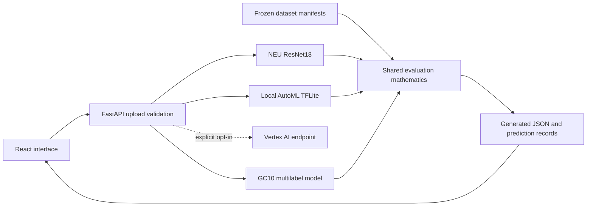

# Steel Defect Detection

Compare a custom PyTorch ResNet18 with Google AutoML Vision exported to TensorFlow
Lite, alongside a separate GC10 multilabel baseline.

## What it does

- Compares the custom classifier and exported AutoML model on the NEU six-class task.
  A Vertex AI endpoint is an optional, explicitly enabled fallback; local TFLite is the default.
- Runs a separate GC10 ten-class multilabel experiment using a frozen NEU-trained
  ResNet18 backbone and a locally trained classifier head.
- Provides a FastAPI and React interface for image upload, camera capture, batch
  inference, prediction history, model comparison, and GC10 results.
- Answers steel-domain questions using intent matching and BM25 retrieval.

## Architecture



## Data pipeline

NEU and GC10 remain different tasks. NEU predicts one supported defect category;
GC10 predicts category presence for images that may contain several defects.

File and decoded-pixel checks reject duplicate NEU inputs across splits. GC10
preparation verifies duplicate copies before deduplication, records its explicit
class-label spelling repair, and excludes unknown labels, empty annotations,
conflicting image copies, invalid boxes, and filenames whose capture group cannot
be inferred. The current exclusion rules and split assignments are frozen in
[`data/`](data/). No test split or label was changed during the publication cleanup.

GC10 capture tokens stay in one split. These tokens are inferred from filenames,
not verified physical sheet identities. This reduces a known leakage risk but does
not establish independent camera generalization. Training-only augmentation is
separate from deterministic evaluation preprocessing.

## Evaluation methodology

[`evaluation_metrics.py`](backend/models/evaluation_metrics.py) contains the shared
metrics mathematics. The NEU evaluator uses Pandas for per-image prediction tables
and grouped error analysis, and NumPy for confusion matrices, abstentions, and
class-level statistics. GC10 uses multilabel precision, recall, F1 and average
precision. The tasks are not combined into one accuracy ranking.

Reports preserve model and dataset identities. Validation data selects GC10
checkpoints and thresholds; the held-out test is used for reporting. The existing
NEU benchmark has already informed development and is not a fresh independent
holdout. New model choices must not be tuned against the reported test results.

## Generated reports

The README deliberately contains no measured performance figures. Inspect the
machine-readable reports and their scope information:

- [NEU AutoML report](backend/models/AutoML/automl_metrics.json)
- [NEU CustomML report](backend/models/CustomML/custom_metrics_v2.json)
- [GC10 baseline ? frozen ResNet18 backbone](backend/models/GC10/metrics.json)
- [Evaluation audit summary](backend/models/evaluation_audit_summary.json)
- [Evaluation audit and reproduction notes](EVALUATION_AUDIT.md)

Raw local evaluation directories and datasets are excluded from Git. Dashboard
pages read generated JSON; the GC10 page identifies whether its local checkpoint
is available or only the reviewed report snapshot is present.

## Engineering notes

The evaluator exposed an AutoML input-normalization mismatch and an external
label-order mismatch. Inference now follows the exported normalization metadata
and verifies the label order against the embedded label file. Confidence is
reported as certainty, not treated as evidence of superior model quality.

The current GC10 baseline reuses the existing NEU-trained backbone as a frozen
feature extractor. Only its new classifier head was trained for GC10; it is not a
claim of end-to-end GC10 backbone training.

## Tech stack

Python, PyTorch/torchvision, TensorFlow Lite, FastAPI, Pandas, NumPy, scikit-learn,
React, TypeScript, Vite and Tailwind. Development checks use Ruff, scoped strict
mypy, pytest, ESLint and Playwright.

## Quick start

Use Python 3.13 and Node.js 24. From the repository root:

```powershell
.\scripts\setup.ps1
.\scripts\download_weights.ps1
.\scripts\run_dev.ps1
```

Bash equivalents:

```bash
bash scripts/setup.sh
bash scripts/download_weights.sh
bash scripts/run.sh
```

The weight verifier checks SHA-256 identities in [`artifacts/models.json`](artifacts/models.json).
Release URLs are intentionally unset pending owner approval and redistribution
provenance review. Existing approved local weights can be verified in place or
restored using `--source-dir` with a local bundle that preserves manifest paths.
A fresh clone cannot run model predictions until those weights are provisioned.
Informational routes and fixture tests do not require them.

The frontend uses `VITE_API_BASE_URL`; the backend uses the typed configuration
in [`backend/config.py`](backend/config.py). Copy [`.env.example`](.env.example) to
`.env` if setup has not already done so. Frontend demo sign-in is disabled by
default. `VITE_DEMO_MODE=true` explicitly enables demonstration controls; any
`VITE_*` setting is public browser configuration, never a secret. There is no
server-side authentication.

Optional Vertex integration requires `backend/requirements-vertex.txt`,
`ENABLE_VERTEX_AI=true`, and configured project/endpoint credentials. Do not place
service-account files in the repository. A working local TFLite model takes
priority; its inference failure is surfaced without silently issuing a paid call.

### Data and training

Obtain datasets from their documented sources before verifying the frozen manifests:

```powershell
.\scripts\prepare_data.ps1 --neu-root backend/models/neu_final_dataset_fullnames --gc10-root backend/models/archive
.\scripts\train_neu.ps1 --data_dir ../neu_final_dataset_fullnames --output_dir outputs_new_run --seed 42
.\scripts\train_gc10.ps1 --out-dir backend/models/GC10/outputs_local_v2
```

Equivalent Bash wrappers have the same filenames with `.sh`. See the
[data acquisition and verification instructions](data/SOURCES.md),
[GC10 experiment guide](backend/models/GC10/README.md), and
[shared evaluation guide](backend/models/SHARED_EVALUATION.md).

### Evaluate

```powershell
.\scripts\evaluate.ps1 neu --test-dir backend/models/neu_final_dataset_fullnames/test --reference-dir backend/models/neu_final_dataset_fullnames/train --reference-dir backend/models/neu_final_dataset_fullnames/val --out-dir backend/models/evaluation_reports/new-neu-run
.\scripts\evaluate.ps1 gc10 --out-dir backend/models/evaluation_reports/new-gc10-run
```

```bash
bash scripts/evaluate.sh neu --test-dir backend/models/neu_final_dataset_fullnames/test --reference-dir backend/models/neu_final_dataset_fullnames/train --reference-dir backend/models/neu_final_dataset_fullnames/val --out-dir backend/models/evaluation_reports/new-neu-run
bash scripts/evaluate.sh gc10 --out-dir backend/models/evaluation_reports/new-gc10-run
```

## Tests and CI

```powershell
.\.venv\Scripts\python.exe -m ruff check backend tests scripts
.\.venv\Scripts\python.exe -m ruff format --check backend tests scripts
.\.venv\Scripts\python.exe -m mypy
.\.venv\Scripts\python.exe -m pytest -m "not requires_weights and not requires_datasets and not live_api" --cov --cov-report=xml
npm --prefix frontend run lint
npm --prefix frontend run typecheck
npm --prefix frontend run build
cd frontend
npx playwright install chromium
npm test
```

[`CI`](.github/workflows/ci.yml) runs small-fixture checks on push and pull request,
without GCP secrets, datasets, or downloaded checkpoints. Tests needing artifacts
are marked `requires_weights` and/or `requires_datasets`; live API tests are
separately marked. Strict mypy covers the explicit new/refactored module list in
`pyproject.toml`; untouched legacy code is not subjected to a blanket strict migration.

## Roadmap

- Evaluate fine-tuning of the last backbone block using training/validation data.
- Add independently collected capture conditions and a separately governed final holdout.
- Design and validate normal/unknown-class handling before extending model scope.

## Scope

A research and portfolio project, not intended for production acceptance decisions.

## Datasets and attribution

NEU data belongs to its original providers, Kechen Song and Yunhui Yan at
Northeastern University: [official database](https://faculty.neu.edu.cn/songkc/en/zdylm/263270/list/index.htm).
GC10 belongs to its original authors: [official repository](https://github.com/lvxiaoming2019/GC10-DET-Metallic-Surface-Defect-Datasets)
and [Lv et al., Sensors, DOI: 10.3390/s20061562](https://doi.org/10.3390/s20061562).

The code uses third-party architectures and libraries, and the AutoML artifact is
an existing course export whose cloud training lineage remains unverified. See
[third-party notices and publication permissions](THIRD_PARTY_NOTICES.md).
No dataset or weight redistribution licence is inferred from public availability.
A licence for original project code has not yet been selected by the owner.
