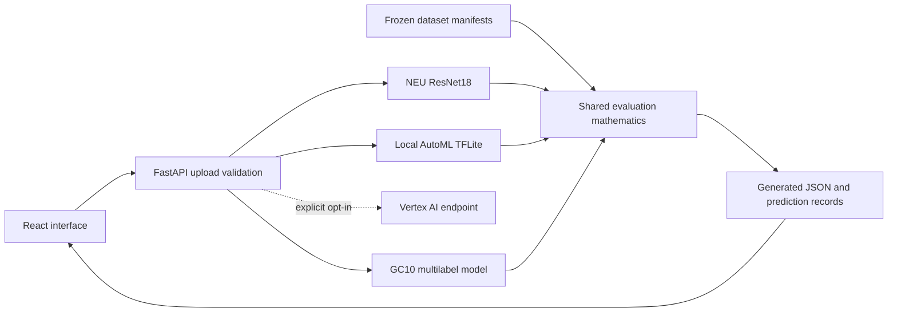

# AI-Powered Steel Defect Detection System

Compare a custom PyTorch ResNet18 with Google AutoML Vision exported to TensorFlow
Lite, alongside a separate GC10 multilabel baseline.

## What it does

- Compares the custom classifier and exported AutoML model on the NEU six-class task.
  A Vertex AI endpoint is an optional, explicitly enabled fallback; local TFLite is the default.
- Runs a separate GC10 ten-class multilabel experiment using a frozen NEU-trained
  ResNet18 backbone and a locally trained classifier head.
- Provides a FastAPI and React interface for image upload, camera capture, batch
  inference, prediction history, model comparison, and GC10 results.
- Answers steel-domain questions using intent matching and BM25 retrieval.

## Architecture



## Data pipeline

NEU and GC10 remain different tasks. NEU predicts one supported defect category;
GC10 predicts category presence for images that may contain several defects.

File and decoded-pixel checks reject duplicate NEU inputs across splits. GC10
preparation verifies duplicate copies before deduplication, records its explicit
class-label spelling repair, and excludes unknown labels, empty annotations,
conflicting image copies, invalid boxes, and filenames whose capture group cannot
be inferred. The current exclusion rules and split assignments are frozen in
[`data/`](data/). No test split or label was changed during the publication cleanup.

GC10 capture groups are kept within one split to prevent leakage. Training-only
augmentation is separate from deterministic evaluation preprocessing.

## Evaluation methodology

[`evaluation_metrics.py`](ml/evaluation_metrics.py) contains the shared
metrics mathematics. The NEU evaluator uses Pandas for per-image prediction tables
and grouped error analysis, and NumPy for confusion matrices, abstentions, and
class-level statistics. GC10 uses multilabel precision, recall, F1 and average
precision. The tasks are not combined into one accuracy ranking.

Reports preserve model and dataset identities. Validation data selects GC10
checkpoints and thresholds; the held-out test is used for reporting. Detailed
split provenance and evaluation limitations are recorded in the audit below.

## Results

<!-- RESULTS:START -->
| Benchmark | Model | Key metrics |
| --- | --- | --- |
| NEU six-class (existing split) | [Google AutoML Vision, TFLite](reports/benchmarks/neu_automl.json) | Accuracy 100.00%; p50 latency 9.80 ms |
| NEU six-class (existing split) | [Custom ResNet18](reports/benchmarks/neu_custom.json) | Deployed accuracy 99.44%; raw accuracy 100.00%; p50 latency 16.91 ms |
| GC10 ten-class multilabel | [Baseline – frozen ResNet18 backbone](reports/benchmarks/gc10.json) | Macro-F1 45.25%; mAP 66.09%; exact-match 18.95% |
<!-- RESULTS:END -->

Both models are near-saturated on the NEU split, which motivated the harder GC10 multilabel benchmark.

Values are generated from the linked reports with `python scripts/update_readme_results.py`.
Latency reflects the recorded local benchmark environment. See the
[evaluation audit](docs/EVALUATION_AUDIT.md) for split provenance, grouping assumptions,
and the distinction between raw predictions and deployed abstention handling.

## Engineering notes

The evaluator exposed an AutoML input-normalization mismatch and an external
label-order mismatch. Inference now follows the exported normalization metadata
and verifies the label order against the embedded label file.

Only the classifier head was trained on GC10; the NEU-trained ResNet18 backbone stays frozen.

## Tech stack

Python, PyTorch/torchvision, TensorFlow Lite, FastAPI, Pandas, NumPy, scikit-learn,
React, TypeScript, Vite and Tailwind. Development checks use Ruff, scoped strict
mypy, pytest, ESLint and Playwright.

## Quick start

Use Python 3.13 and Node.js 24. From the repository root:

```powershell
.\scripts\setup.ps1
.\scripts\download_weights.ps1
.\scripts\run_dev.ps1
```

Bash equivalents:

```bash
bash scripts/setup.sh
bash scripts/download_weights.sh
bash scripts/run.sh
```

Download and verify the `v1.0.0` model assets with `scripts/download_weights.ps1`
(or `bash scripts/download_weights.sh`). SHA-256 identities and release URLs are
recorded in [`models/registry.json`](models/registry.json). The GC10 head uses the
custom NEU checkpoint as its frozen backbone; all three models run locally.
Reference cards use placeholders; predictions run on images you upload.

The frontend uses `VITE_API_BASE_URL`; the backend uses the typed configuration
in [`backend/core/config.py`](backend/core/config.py). Copy [`.env.example`](.env.example) to
`.env` if setup has not already done so. Frontend demo sign-in is disabled by
default. `VITE_DEMO_MODE=true` explicitly enables demonstration controls; any
`VITE_*` setting is public browser configuration, never a secret. See [deployment configuration](docs/DEPLOYMENT.md).

Optional Vertex integration requires `requirements/requirements-vertex.txt`,
`ENABLE_VERTEX_AI=true`, and configured project/endpoint credentials. Do not place
service-account files in the repository. A working local TFLite model takes
priority; its inference failure is surfaced without silently issuing a paid call.

### Data and training

Obtain datasets from their documented sources before verifying the frozen manifests:

```powershell
.\scripts\prepare_data.ps1 --neu-root data/processed/neu --gc10-root data/raw/gc10
.\scripts\train_neu.ps1 --data_dir data/processed/neu --output_dir models/CustomML/outputs_new_run --seed 42
.\scripts\train_gc10.ps1 --out-dir models/GC10/outputs_local_v2
```

Equivalent Bash wrappers have the same filenames with `.sh`. See the
[data acquisition and verification instructions](data/SOURCES.md),
[GC10 experiment guide](docs/GC10.md), and
[shared evaluation guide](docs/SHARED_EVALUATION.md).

### Evaluate

```powershell
.\scripts\evaluate.ps1 neu --test-dir data/processed/neu/test --reference-dir data/processed/neu/train --reference-dir data/processed/neu/val --out-dir reports/runs/new-neu-run
.\scripts\evaluate.ps1 gc10 --out-dir reports/runs/new-gc10-run
```

```bash
bash scripts/evaluate.sh neu --test-dir data/processed/neu/test --reference-dir data/processed/neu/train --reference-dir data/processed/neu/val --out-dir reports/runs/new-neu-run
bash scripts/evaluate.sh gc10 --out-dir reports/runs/new-gc10-run
```

## Tests and CI

```powershell
.\.venv\Scripts\python.exe -m ruff check backend ml tests scripts
.\.venv\Scripts\python.exe -m ruff format --check backend ml tests scripts
.\.venv\Scripts\python.exe -m mypy
.\.venv\Scripts\python.exe scripts/update_readme_results.py --check
.\.venv\Scripts\python.exe -m pytest -m "not requires_weights and not requires_datasets and not live_api" --cov --cov-report=xml
npm --prefix frontend run lint
npm --prefix frontend run typecheck
npm --prefix frontend run build
cd frontend
npx playwright install chromium
npm test
```

[`CI`](.github/workflows/ci.yml) runs small-fixture checks on push and pull request,
without GCP secrets, datasets, or downloaded checkpoints. Tests needing artifacts
are marked `requires_weights` and/or `requires_datasets`; live API tests are
separately marked. Strict mypy covers the explicit new/refactored module list in
`pyproject.toml`; untouched legacy code is not subjected to a blanket strict migration.

## Roadmap

- Evaluate fine-tuning of the last backbone block using training/validation data.
- Add independently collected capture conditions and a separately governed final holdout.
- Design and validate normal/unknown-class handling before extending model scope.

## Scope

A research and portfolio project, not intended for production acceptance decisions.

## Datasets and attribution

NEU data belongs to its original providers, Kechen Song and Yunhui Yan at
Northeastern University: [official database](https://faculty.neu.edu.cn/songkc/en/zdylm/263270/list/index.htm).
GC10 belongs to its original authors: [official repository](https://github.com/lvxiaoming2019/GC10-DET-Metallic-Surface-Defect-Datasets)
and [Lv et al., Sensors, DOI: 10.3390/s20061562](https://doi.org/10.3390/s20061562).

I trained the Google AutoML Vision model on Google Cloud (Vertex AI AutoML) for a course project.

Code: MIT. Datasets and third-party components keep their original licences.
See [LICENSE](LICENSE) and [third-party notices](docs/THIRD_PARTY_NOTICES.md).

## Repository organization

See [folder responsibilities](docs/STRUCTURE.md) and [deployment setup](docs/DEPLOYMENT.md).
Training and evaluation live in `ml/`, tests in `tests/`, and Python dependency lists
in `requirements/`. Datasets, checkpoints, and generated reports are separated into
`data/`, `models/`, and `reports/`; see the folder guide for path compatibility.
